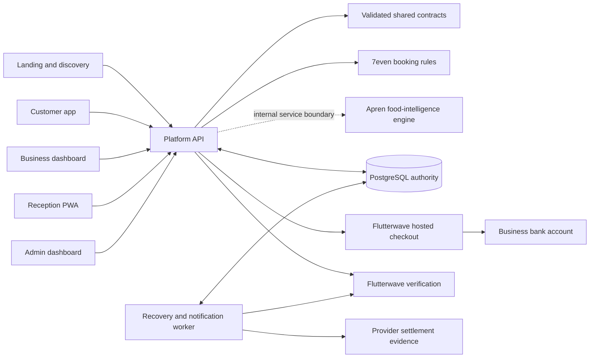

# 7even architecture

16 October 2026. This describes the implemented local rebuild and the boundaries that later work must preserve. [Build proposal](BUILD_PROPOSAL.md), [API contract](API_CONTRACT.md), [file guide](FILE_GUIDE.md), [operations](OPERATIONS.md) and [threat model](../security/tma.md) provide the detailed contracts and release limits.

## One authority, five surfaces

The landing site, customer account, business dashboard, reception workspace and admin dashboard are routes in one responsive React application branded 7even. They use the same relative `/api` service and PostgreSQL records. The 7even-specific TypeScript engine contains exact arithmetic, dates, lifecycle and hospitality demand rules without network or database effects. Apren is a separate internal food-intelligence service, exposed at `services/apren-engine`; the platform can check its health through `APREN_ENGINE_URL`. Shared contracts validate requests and describe response projections. Backend modules coordinate authorized transactions and external provider work.

The active root workspace runs five packages: the 7even web app, 7even platform API, Apren engine service, shared contracts and 7even booking rules. The former assets service was promoted from `legacy/services/assets` to `services/apren-engine` without changing the 7even rebuild branch. Remaining historical services, old web source and generators stay under `legacy/` and are not started by the active runtime. The Apren health boundary is operational; production persistence and a domain-specific hospitality-to-Apren intelligence contract remain release gates.

## Reservation and value flow

1. An approved business publishes an offering and availability at an active venue. A stay reserves each night in a half-open date range; dining and experiences use explicit service windows. Inventory is shared by online and reception bookings.
2. The server loads current offering and policy terms and creates an immutable exact quote. A reservation locks every required inventory window in stable order, checks available capacity and allocates a temporary hold atomically.
3. Checkout records durable intent, provider mode, exact amount, commission, merchant reference and approved bank/subaccount revision before dispatching to the provider. A timeout can remain uncertain; another request cannot simply issue another checkout effect.
4. Authenticated provider notification enters a durable inbox. The server independently queries transaction status and checks amount, currency and identity. The committed receipt changes payment/reservation state and creates balanced journal postings. Browser claims never do this.
5. Reception changes service state through the same revisioned lifecycle. Verified funding plus completed service grants points once under the accepted earning-policy snapshot. An external-payment note is an operational note, not provider proof or a points grant.
6. Points can redeem a published business-funded reward. The resulting benefit is separate from the reservation. Only eligible benefits can be gifted/swapped; acceptance locks ownership, checks revisions and rotates the claim code. The issuing business can consume it once.
7. Settlement reconciliation remains separate from payment verification. It checks per-transaction bank destination, completed provider status, actual fees and business net. Refunds and points reversals create compensating history. An extra receipt or contradiction remains recorded for review.

## Boundaries and invariants

| Boundary | Enforced rule |
|---|---|
| Identity | Opaque cookie sessions are stored hashed. Server-loaded active user/membership determines role and business context. Mutation origin, CSRF and strict request validation are enforced. Recovery links are short-lived, single-use and hashed at rest. |
| Tenant and venue | Business is the tenant; venue narrows reception access. Customer resources require ownership; owner/admin workflows require role checks. Replayed cached results are reauthorized. PostgreSQL RLS is not implemented, so a route omission or compromised runtime credential remains material. |
| Capacity | The authoritative transaction locks all inventory rows and reservation revisions. Holds expire explicitly. A late payment never recreates released inventory. The device queue cannot allocate shared capacity. |
| Amounts | NGN amounts use exact integer kobo or exact decimal text at provider boundaries. The engine applies explicit bounds and rounding. Commission uses discounted service before separately stated tax, and actual provider fees reduce the business share. |
| Journal | Monetary postings balance per NGN journal; point postings balance independently. Unique source references prevent duplicate effects. Committed financial history is append-only; corrections use compensating entries. Balances are projections, not the only record. |
| Idempotency | Durable keys bind actor, operation and canonical payload. Uniqueness, advisory/row locks, revisions and atomic state/journal commits enforce replay safety across workers. No distributed exactly-once claim is made. |
| External uncertainty | Checkout/refund intent is durable before dispatch. Unknown outcomes remain visible and are reconciled. Provider notifications are deduplicated, leased and independently verified. A charge success differs from settlement to a bank. |
| Local reception | IndexedDB stores only supported operational IDs, revisions and outcomes. Atomic queue updates preserve in-flight additions. Acknowledged effects clear; conflicts remain. Logout/context change purges scopes. Private API responses are never service-worker cached. |
| Operations | Inbox/outbox attempts and leases persist. Failed work remains visible. The application role is separate from migration ownership; runtime deletion rights are reduced. Backup, restore, alerting and human operating procedures still need deployment evidence. |

`seven_owner` owns schema objects, `seven_app` supplies runtime privileges and `seven_readonly` supplies read-only privileges. Separate login credentials inherit the required group. Migration administration must not be the deployed runtime credential. Runtime authorization still spans multiple tenants inside one schema; privilege separation reduces consequences but does not make that application boundary disappear.

## Demand intelligence

The engine measures persisted nonsynthetic observations over a seven-day window and returns counts, readiness, reasons and deterministic recommendations. Low evidence produces an explicit insufficient-data result. Goal-aware rules exist in the engine; the current business API supplies the `BALANCED` goal. The seed labels fictional businesses, and both new and existing sample observations are marked synthetic and excluded.

This is a transparent baseline, not a trained forecasting model or proof of prediction accuracy. No autonomous pricing publication occurs. Validate outcomes against real authorized business data before making claims about revenue lift or demand quality.

## Adding sectors and hotel integrations

The 7even booking engine implements the sector vocabulary `STAY`, `DINING` and `EXPERIENCE`. It separates common money, dates and lifecycle rules from backend/provider effects. Apren remains the separate food-intelligence and food-economy engine; do not collapse the two codebases merely because both use the word “engine”. Offerings, availability, quote snapshots, reservations, business/venue ownership, rewards and event observations are shared concepts. That separation makes another sector possible without a second wallet, payment authority or customer identity system.

A new sector is a deliberate versioned change, not a runtime plugin switch. Define its capacity unit, date/window semantics, fulfillment and cancellation rules, tax display, reward eligibility and demand observations. Extend strict contracts and lookup data, add a forward migration where persisted vocabulary changes, then implement sector presentation and adversarial inventory/authorization tests. Preserve accepted quote/policy snapshots for existing bookings. Do not pass arbitrary sector JSON through to financial or inventory decisions.

The current first-party reception source and versioned sync contract form the integration boundary. A future PMS adapter must map vendor records into stable source/event identities, reconcile revisions and recheck business/venue permission. It must distinguish an external payment observation from verified 7even provider funding, preserve conflict evidence, and define retry/recovery without duplicating capacity or value. No vendor product/version, vendor credentials or working third-party adapter is selected yet.

## Brand and calendar presentation

The client-supplied Forest Green, Warm Ivory, Sand / Champagne, Deep Charcoal and Warm Taupe palette is shared by the five application surfaces. Four proposed seasonal accents affect only campaign presentation. A pure `season.ts` calendar selects March-May Spring, June-August Summer, September-November Autumn and December-February Winter in `Africa/Lagos`. One `SeasonProvider` owns the bounded timer and resume listeners; it supplies both the landing's credited editorial campaign and the CSS `data-season` selector. Main actions stay Forest Green. The device clock can affect campaign appearance, but does not decide capacity, prices, points, payment or authorization. No backend setting, external scheduler or environment secret is added. [Seasonal themes](SEASONAL_THEMES.md) records exact colors, timing, cleanup, provenance, verification and browser limitations.

## Deliberate local limits

Flutterwave test credentials/subaccounts and real SMTP delivery are unavailable. Local provider and transport doubles prove code properties, not real gateway or mailbox behavior. Nodemailer is locked but its new package download was blocked by registry access in this session. The PWA has no native installer and cannot repopulate private reception data after a cold offline restart. Administrators have no second factor, and bank changes have no independent maker-checker approval. Production security scans, provider agreement, monitoring, restore exercises, qualified review and applicable Nigerian obligations remain release gates. No production deployment or merger of this working tree has occurred.
