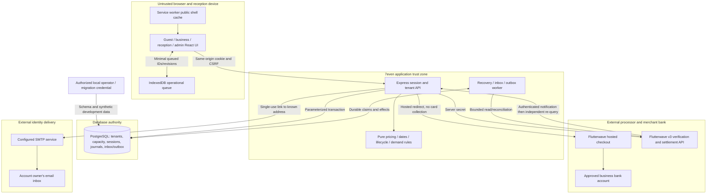

# Threat Model: 7even hospitality platform

**Last refreshed:** 16 October 2026 at base commit `26d61a4aaf0ee87411b57df2ac94a5e5ad607e33`.
**Working tree:** The rebuilt system is uncommitted. The base commit contains Apren, not the implementation described below. Frozen implementation SHA-256: `07db2067adeedb97f0b1fb0315f0a33328f088cf8b0c8bbbaa85815ad659ff47` (105 files). No commit or deployment was made. The source hash identifies the inspected files without claiming HEAD contains the rebuild.
**Hash method:** Take sorted POSIX paths from `rg --files apps/web services/platform packages database/migrations tests scripts`, plus `.env.example`, `.gitignore`, `package.json`, `package-lock.json`, `tsconfig.json` and `biome.json`. For each path, append its UTF-8 path, one NUL byte, its raw bytes and one NUL byte to a SHA-256 stream. Generated/ignored build output, dependencies, private configuration, documentation, design evidence and historical source are excluded. Documentation-only updates do not change this implementation digest.
**Scope:** Implemented `apps/web`, `services/platform`, `packages/contracts`, `packages/engine`, `database/migrations`, local runtime scripts/configuration, and approved planned production boundaries. **Out of scope:** Historical `legacy/` execution, vendor PMS products not selected, native operating-system installers, compromised browser/OS/DB superuser defenses, card processing inside Flutterwave, provider/bank internals, and a legal/PCI/privacy certification.

Severity follows the installed Helios [vulnerability taxonomy](../../../../.codex/plugins/cache/helios-sdlc-devkit/helios-sdlc-devkit/1.5.0/references/vulnerability-taxonomy.md). Ratings below describe the stated attacker position and impact. A missing external test is an evidence gap, not a fabricated exploit. “Implemented” means the modeled element and cited control exist; “Planned” means the named environment/control has not been shown deployed.

## 1. System elements and trust boundaries

The browser is never authority for role, business membership, quote price, payment success, settlement, points or inventory. Business is the tenant; venue membership further narrows reception. PostgreSQL transactions are the authority for accepted state. Provider calls are external effects and are not made atomic with a database transaction. A reception source is bound to a user and business, not an independently trusted native hotel adapter.

Sensitive data consists of customer/staff email, display name and phone; reservation/service history; membership; bank mapping; session/recovery hashes; temporary recovery links; payment references and entitlement codes. No active card-number/CVV collection or PHI flow was found in the modeled code. This observation is not a policy allowing health information to be added later. Bank account snapshots remain server-side; public business projections expose an account label/configured flag rather than the account number (`services/platform/src/store.ts:164`).

## 2. Threat actors

| Actor | Position and capability | In scope |
|---|---|---|
| Anonymous internet client | Calls public/auth endpoints, sends malformed JSON, forges callbacks and tries credentials | Yes |
| Authenticated guest | Knows its own IDs, can repeat/concurrently send mutations and guess another account's IDs | Yes |
| Malicious business or reception member | Has valid membership but seeks sibling venue/customer/tenant records or extra financial effects | Yes |
| Phished platform administrator | Possesses a working admin password/session and can call admin routes | Yes; no MFA currently exists |
| Compromised reception browser | Can edit local queue/JavaScript and replay captured source/event IDs | Yes, up to server revalidation; OS persistence defenses are outside scope |
| Delayed/duplicated or contradictory provider event | Valid provider notification with stale/order/amount/delivery differences | Yes; independent provider behavior must be tested |
| Compromised dependency or runtime credential | Runs with application privileges or accesses its PostgreSQL connection | Yes for least-privilege/release risk; arbitrary runtime compromise is not prevented by unit tests |
| Privileged DB/host/provider/bank operator | Can bypass application controls at infrastructure or provider level | Outside preventive scope; recovery, review and audit independence remain relevant |

## 3. STRIDE by element

### E1. Public browser, React UI and static delivery

| Threat (STRIDE) | Existing mitigation with source evidence | Residual risk and severity | Tag |
|---|---|---|---|
| S: Browser claims a privileged role or successful payment | Client session comes from `/auth/session`; server reconstructs actor from session hash (`services/platform/src/app.ts:99`); provider return calls server verification (`apps/web/src/pages/customer/PaymentPages.tsx`) | **Low** for client-only spoofing after server checks; stolen server sessions are covered under E2 | Implemented |
| T: Manipulated price, quote, request or checkout URL | Strict input contracts (`packages/contracts/src/index.ts`), server quote (`services/platform/src/reservations.ts:50`), exact checkout origin validator (`apps/web/src/pages/customer/checkout.ts`) | **Low** for the modeled input manipulation; changes must retain both server and redirect checks | Implemented |
| R: UI displays local action as accepted | API rejects bad envelopes (`apps/web/src/lib/api.ts:48`); queue retains pending/conflict state (`apps/web/src/lib/receptionQueue.ts:109`); payment pages label local test mode | **Low**; screenshots and client state remain non-authoritative evidence | Implemented |
| I: Private API records enter shared cache or recovery link leaks via referrer | Service worker bypasses `/api/` (`apps/web/public/sw.js:29`); API sets no-store (`services/platform/src/app.ts:80`); recovery page removes token URL and adds no-referrer (`apps/web/src/pages/account/RecoveryPages.tsx:7`) | **Medium** on a compromised/shared device because in-memory views and short-lived URLs exist; no complete device security or retention policy is proved | Implemented |
| D: Unavailable API or runtime render failure blanks the whole product | Abort/retry/backoff hook (`apps/web/src/hooks/useApi.ts:24`), visible errors and boundary (`apps/web/src/App.tsx:92`) | **Medium** availability risk remains without deployed monitoring, tested ingress limits or service failover | Implemented / Planned environment |
| E: Script injection uses authenticated browser authority | React text rendering and no active unsafe HTML renderer found; checkout and notification destinations constrained (`checkout.ts`; `services/platform/src/store.ts:44`) | **Medium** defense gap: no deployed CSP was identified; a future unsafe renderer or compromised dependency would inherit the session's authority | Implemented / Planned hardening |

### E2. Authentication, sessions and account recovery

| Threat (STRIDE) | Existing mitigation with source evidence | Residual risk and severity | Tag |
|---|---|---|---|
| S: Credential stuffing or session guessing | Random 32-byte tokens and scrypt hashes (`services/platform/src/auth.ts:7`); hashed stored sessions and HttpOnly/SameSite cookie (`services/platform/src/app.ts:147`); minimum password length in contracts | **High** for a phished admin credential: there is no second factor; a valid password exposes broad admin authority | Implemented; MFA planned |
| T: Cross-site mutation or password reset replay | Exact Origin and hashed CSRF checks (`services/platform/src/app.ts:124`); reset completion consumes hashed expiring token under user/recovery row locks and revokes sessions (`services/platform/src/accounts.ts:108`) | **Low** for modeled replay/CSRF with existing checks; real browser and email security remain external assumptions | Implemented |
| R: Account change lacks attribution | Account change/recovery audit and recipient notification (`services/platform/src/accounts.ts:120`; `services/platform/src/accounts.ts:126`) | **Medium**: audit records share the application database; independent tamper-evident log export is not implemented | Implemented |
| I: Recovery reveals account existence, token or password | Uniform response/delay, private asynchronous delivery and only token hash in PG (`services/platform/src/accounts.ts:74`); passwords excluded from projections (`services/platform/src/store.ts:135`) | **Medium**: database or mailbox access reveals sensitive identity/history, and development recovery mailbox intentionally holds live local fixture links | Implemented |
| D: Automated sign-in floods or scrypt resource exhaustion | Body limit (`services/platform/src/app.ts:89`), persisted login/register counters (`services/platform/src/accounts.ts:51`) and recovery limits (`services/platform/src/accounts.ts:42`) | **Medium**: the account/IP counters are shared across workers, but the production reverse-proxy identity policy and ingress-wide request budgets are unverified | Implemented / Planned hardening |
| E: Registration self-assigns admin or reset changes another account | Strict registration schema rejects role (`packages/contracts/test/contracts.test.ts:5`); registration inserts CUSTOMER (`services/platform/src/app.ts:332`); reset identifies user from token, not caller ID (`services/platform/src/accounts.ts:114`) | **Low** for these modeled escalation paths; privilege provisioning and administrator access require qualified review | Implemented |

### E3. Business, venue and resource API authorization

| Threat (STRIDE) | Existing mitigation with source evidence | Residual risk and severity | Tag |
|---|---|---|---|
| S: Caller supplies another tenant or source identity | Actor comes from live user/membership projection (`services/platform/src/store.ts:135`); requireTenant/requireVenue (`services/platform/src/store.ts:518`); source is checked against actor/business (`services/platform/src/app.ts:1093`) | **Low** for supplied-ID spoofing; current actor selection supports one active business context, not an arbitrary multi-business switcher | Implemented |
| T: Concurrent stale edits or repeat requests overwrite another state | Expected revision checks, tenant filters and durable actor/key/payload replay records (`services/platform/src/app.ts:169`; `services/platform/src/operations.ts:24`) | **Medium** if future routes omit shared checks; application-level enforcement has no PG row-level-security backstop | Implemented |
| R: Owner/staff denies changes or moderation | Attributable audit plus outbox (`services/platform/src/store.ts:26`); staff revocation audits (`services/platform/src/app.ts:1025`); moderation reason fields (`services/platform/src/operations.ts:249`) | **Medium** because the broad application role can write operational/audit tables; immutable financial journals do not make every audit row immutable | Implemented |
| I: Guest, sibling venue or revoked staff reads another resource | Reservation access joins offering venue (`services/platform/src/reservations.ts:214`); scoped overviews (`services/platform/src/app.ts:759`); replayed cached reservation response is reauthorized (`services/platform/src/app.ts:185`) | **High** impact if a route-level omission occurs: database credential is tenant-wide. Existing isolation tests reduce specific demonstrated paths, not all future routes | Implemented |
| D: Wide listing/overview or repeated mutations exhaust PG | Catalog/page and worker limits (`services/platform/src/app.ts:382`; `services/platform/src/worker.ts:79`); pool max 12 and connection timeout (`services/platform/src/db.ts:4`); body limit (`services/platform/src/app.ts:89`) | **Medium**: production workload/load shedding and API-wide abuse limits are unverified; some overview queries are bounded only by retained tenant history | Implemented / Planned environment |
| E: Reception gains owner/admin operations after revocation | Role gates and membership reconstruction (`services/platform/src/app.ts:32`; `services/platform/src/store.ts:135`); deletion revokes sessions/sources (`services/platform/src/app.ts:1025`) | **Low** for tested revoked-staff and sibling-venue cases; no formal complete authorization proof | Implemented |

### E4. Inventory, reservations, journals and benefit ownership

| Threat (STRIDE) | Existing mitigation with source evidence | Residual risk and severity | Tag |
|---|---|---|---|
| S: Customer invents a quote/owner/payment to gain service or points | Quote belongs to authenticated actor (`services/platform/src/reservations.ts:135`); server-generated benefit/reward records (`services/platform/src/benefits.ts:16`); point earning requires paid plus fulfilled (`services/platform/src/reservations.ts:275`) | **Low** for modeled forged inputs; dishonest authorized staff can still assert service fulfillment and needs operational controls | Implemented |
| T: Last-room race, point overspend, duplicate grant or history rewrite | Stable row locks and revision checks (`services/platform/src/reservations.ts:135`); user lock/unique source journal (`services/platform/src/store.ts:91`); deferred balance triggers (`database/migrations/001_initial.sql:335`); journal immutability (`database/migrations/002_scope_and_funding.sql:10`) | **Low** for the tested races/duplicate effects and explicit PG rollback boundary (`tests/integration/recovery-crash.test.ts:99`); infrastructure restore and uncontrolled outage behavior remain unverified | Implemented |
| R: Movement cannot be traced or correction erases its source | Unique source-referenced journal headers and compensating refunds (`services/platform/src/store.ts:70`; `services/platform/src/payments.ts:354`); attributable audit (`services/platform/src/store.ts:26`) | **Medium** for operator-level manipulation/restoration: all records remain in one database and backup integrity/reconciliation drills are unverified | Implemented / Planned operations |
| I: Entitlement claim code or customer booking leaks across accounts | Customer overview selects self (`services/platform/src/app.ts:567`); issuing-business authorization on consumption (`services/platform/src/benefits.ts:63`); private API no-store | **Medium** on stolen session/shared screen; code is a bearer-like operational secret and must not enter logs/screenshots | Implemented |
| D: Long date range or allocation locks block other bookings | Range capped at 366 nights (`packages/engine/src/lifecycle.ts`), request limits in contracts and deterministic lock order (`services/platform/src/reservations.ts:175`) | **Medium**: sustained authenticated locking traffic, query deadlines and real load remain untested | Implemented / Planned environment |
| E: Booking becomes transferable, stale owner consumes, or offline note awards points | Benefit table is separate from reservations (`database/migrations/001_initial.sql:230`); benefit revision/eligibility transaction (`services/platform/src/benefits.ts:181`); payment notes explicitly do not change payment state (`services/platform/src/operations.ts:157`) | **Low** for implemented eligibility separation; complete gift/swap adversarial review still required | Implemented |

### E5. Flutterwave checkout, webhook, refund and bank boundary

| Threat (STRIDE) | Existing mitigation with source evidence | Residual risk and severity | Tag |
|---|---|---|---|
| S: Forged redirect/webhook marks paid | Selected v3 `verif-hash` uses constant-time comparison (`services/platform/src/provider.ts:50`); webhook durable receipt (`services/platform/src/app.ts:526`); independent provider re-query and identity checks (`services/platform/src/payments.ts:295`) | **Medium** evidence gap: actual account protocol/configuration is not exercised. A v4 HMAC deployment must use its own adapter, never silent fallback | Implemented / Planned account configuration |
| T: Amount/currency/reference/subaccount/fee is altered | Exact provider decimal parser (`services/platform/src/provider.ts:36`), immutable attempt/commission/bank snapshot (`services/platform/src/payments.ts:20`), receipt checks (`services/platform/src/payments.ts:145`), settlement transaction/bank/net checks (`services/platform/src/payments.ts:593`) | **High** release risk until the real account proves the split and fee semantics. This is not a claim that the deterministic adapter test demonstrates provider agreement | Implemented / Planned external verification |
| R: Timeout or duplicate charge is silently retried or lost | Intent committed before dispatch (`services/platform/src/payments.ts:20`; `services/platform/src/payments.ts:438`); duplicate actual receipts separately journaled (`services/platform/src/payments.ts:203`); UNKNOWN and no blind refund redispatch (`services/platform/src/payments.ts:528`) | **Medium**: unknown refunds without provider ID need manual lookup; no API is claimed to guarantee distributed exactly-once delivery | Implemented |
| I: Secret key/card/bank details reach client or logs | Server-only environment secret and fixed provider host (`services/platform/src/provider.ts:90`), hosted card checkout, public bank-label projection (`services/platform/src/store.ts:164`), redacted inbox payload (`services/platform/src/app.ts:536`) | **Medium**: privileged server/database access still exposes bank snapshots and credentials; production secret-manager/rotation and log sink review are unverified | Implemented / Planned environment |
| D: Provider outage or webhook flood blocks service | 15-second fetch timeout (`services/platform/src/provider.ts:90`), durable inbox leases and five-attempt bound (`services/platform/src/worker.ts:79`), bounded settlement reads (`services/platform/src/payments.ts:593`) | **Medium**: validly authenticated flood can grow inbox; payment verification is external and infrastructure queue alerts are not deployed | Implemented / Planned operations |
| E: Merchant bank mapping or admin action diverts settlement | ADMIN gate plus provider subaccount lookup and Nigerian account checks (`services/platform/src/app.ts:1309`); bank revision snapshot (`services/platform/src/payments.ts:20`) | **High** for a phished admin or improper onboarding: no maker-checker bank-change workflow or independent merchant ownership evidence is implemented | Implemented / Planned review |

### E6. Inbox/outbox/reconciliation worker

| Threat (STRIDE) | Existing mitigation with source evidence | Residual risk and severity | Tag |
|---|---|---|---|
| S: Arbitrary event impersonates trusted provider/business | Inbox enters through authenticated webhook and later re-query (`services/platform/src/app.ts:526`; `services/platform/src/worker.ts:79`); business events are created inside audit transaction (`services/platform/src/store.ts:26`) | **Low** for public injection; a compromised application DB credential can forge operational rows | Implemented |
| T: Two workers duplicate effects or crashed claims never recover | FOR UPDATE SKIP LOCKED, lease IDs/expiry and idempotent receipt application (`services/platform/src/worker.ts:79`); pending local claim recovery (`services/platform/src/worker.ts:11`) | **Medium** for infrastructure restore and production clock/lease behavior; literal local process-kill and fresh-worker lease recovery are exercised (`tests/integration/recovery-crash.test.ts:80`) | Implemented / Planned operational verification |
| R: Failed work disappears or is mistaken for complete | Attempts/error/backoff retained (`services/platform/src/worker.ts:114`; `services/platform/src/worker.ts:179`); admin operations expose failures (`services/platform/src/operations.ts:198`) | **Medium**: staff response ownership and external alert delivery are not deployed | Implemented / Planned operations |
| I: Notification crosses a venue boundary | Outbox consumer scopes active memberships to event venue (`services/platform/src/worker.ts:148`); notification read requires recipient (`services/platform/src/app.ts:632`) | **Low** for modeled event routing; audit/free-text content should remain minimal | Implemented |
| D: Endless retry or parallel interval overload | Local interval guard (`services/platform/src/server.ts:11`); bounded inbox/outbox batch/attempts (`services/platform/src/worker.ts:79`; `services/platform/src/worker.ts:126`); settlement check bounds (`services/platform/src/payments.ts:593`) | **Medium**: pending payment query/reconciliation can revisit uncertain items repeatedly and needs production quota/load tuning | Implemented |
| E: Background worker grants value without authorized evidence | Worker obtains provider receipt and calls same applyReceipt transaction (`services/platform/src/worker.ts:102`); no autonomous price-publishing route | **Low** for current effects; any future PMS or model worker is a new trust boundary and requires model refresh | Implemented |

### E7. Reception IndexedDB, PWA and first-party sync

| Threat (STRIDE) | Existing mitigation with source evidence | Residual risk and severity | Tag |
|---|---|---|---|
| S: Device rewrites source/user/tenant IDs | Session user, active source and venue/resource guards checked server-side (`services/platform/src/app.ts:1093`; `services/platform/src/reservations.ts:214`) | **Low** for a fabricated device ID; one source per user/business is not hardware identity or vendor PMS authentication | Implemented |
| T: Queue race drops event, identity is reused with new payload, or stale revision applies | Atomic IndexedDB transaction (`apps/web/src/lib/receptionQueue.ts:40`), duplicate reservation bound (`apps/web/src/lib/receptionQueue.ts:68`), durable event hash/revision checks (`services/platform/src/app.ts:1123`) | **Low** for covered queue races; a compromised browser can delete its own unsubmitted queue and no server can recover an event it never received | Implemented |
| R: Offline action looks confirmed or conflict silently retries | Explicit pending/conflict UI and manual resolution (`apps/web/src/pages/workspace/ReceptionPage.tsx:166`); APPLIED/DUPLICATE only remove acknowledged event (`apps/web/src/lib/receptionQueue.ts:109`) | **Medium** operational risk if staff ignores conflicts; real cold-start offline install/reload behavior is not proved | Implemented / Planned browser verification |
| I: Previous account's private queue survives logout/tenant change | Queues hold action IDs/revisions only; session restricts queue owner and clears on logout (`apps/web/src/context/SessionContext.tsx:13`; `apps/web/src/context/SessionContext.tsx:51`); no API cache (`apps/web/public/sw.js:29`) | **Medium** for IDs and service operation times on a compromised shared device; successful cold-start intentionally lacks cached private reservations | Implemented |
| D: Offline actions grow without limit | At most 50 queued actions and bounded sync batch (`apps/web/src/lib/receptionQueue.ts:72`; `apps/web/src/pages/workspace/ReceptionPage.tsx:88`) | **Low** resource bound; offline new bookings/payments/benefit use remain unavailable by design | Implemented |
| E: Offline event invents capacity/payment/points authority | Only allowed operational action schema (`packages/contracts/src/index.ts`), same server lifecycle and payment gate (`services/platform/src/app.ts:1140`; `services/platform/src/reservations.ts:224`) | **Low** with server checks; true offline shared inventory would require a separate allotment design | Implemented |

### E8. Recovery email delivery and operational configuration

| Threat (STRIDE) | Existing mitigation with source evidence | Residual risk and severity | Tag |
|---|---|---|---|
| S: Attacker redirects reset to a different recipient or spoofs service | Recipient loaded from matching account request and canonical origin (`services/platform/src/accounts.ts:82`); fixed configured sender (`services/platform/src/recoveryMailer.ts:14`) | **Medium**: DNS sender authentication, mailbox ownership and SMTP provider control are outside local tests | Implemented / Planned environment |
| T: Email content fetches attacker URL/file or SMTP downgrade | Text-only message, URL/file access disabled (`services/platform/src/recoveryMailer.ts:22`); ports 465/587, requiredTLS, verified certificate and TLS 1.2 minimum (`services/platform/src/recoveryMailer.ts:57`) | **Low** for local adapter contract; the new Nodemailer package is locked but its download was blocked; no actual TLS/SMTP server interaction has been verified | Implemented |
| R: Reset email silently lost after commit | Delivery failure revokes link and audits failure (`services/platform/src/accounts.ts:92`); new request supersedes earlier link (`:78`) | **Medium**: send is not a durable mail queue, so crash before send needs user to request a new link; no promise of guaranteed delivery | Implemented |
| I: Local mailbox or environment exposes link/secret | Local mailbox only .test recipients and 0600 writes (`services/platform/src/accounts.ts:25`); environment/local paths excluded from Git (`.gitignore`) | **Medium** on shared development host; actual production secret handling, retention and backup access are unverified | Implemented / Planned environment |
| D: Provider outage or migration/seed misuse prevents recovery/service | SMTP timeouts (`services/platform/src/recoveryMailer.ts:63`); missing production delivery is uniformly unavailable (`services/platform/src/accounts.ts:78`); transactional checksummed migrations (`services/platform/src/migrate.ts:7`) | **Medium**: production mail and backup/restore runbooks not executed; migration credentials need separation from runtime | Implemented / Planned operations |
| E: Privileged seed/migration or supply-chain package changes authority | Explicit nonproduction seed guard (`seed.ts`), active workspace list/pinned lock (`package.json`), schema owner/app groups (`database/migrations/001_initial.sql:5`) | **High** if deployed with an owner/superuser credential or poisoned dependency; the local HTTP runtime uses a restricted `seven_app` login, but production provisioning and fresh complete scan evidence remain unverified | Implemented / Planned deployment |

## 4. Prioritized residual risks and release evidence

1. **High, implemented authentication boundary:** A phished administrator password grants broad power without a second factor. Add a reviewed administrator authentication policy and verified second factor before consequential production access. No exploit was staged against a real account.
2. **High, implemented bank-management boundary:** One administrator can map a bank subaccount. Provider lookup verifies a configured Nigerian account but does not itself prove merchant ownership or provide independent bank-change approval. Define and review onboarding/bank-change controls.
3. **High, planned production database boundary:** The application relies on server authorization and broad schema-wide runtime privileges rather than RLS. The local runtime and HTTP tests use a restricted login inheriting `seven_app`; migration ownership is separate, and migration 007 removes deletion of retained records. Deploying an owner/superuser credential would defeat that separation. Verify production privileges, independent backups and restore/reconciliation evidence.
4. **High release evidence gap, implemented financial adapter:** Flutterwave account/subaccounts are not ready. The approved service commission, actual fee allocation, webhook mode, refund status normalization and bank settlement need provider sandbox/staging evidence. Do not interpret local mocks or deterministic response fixtures as that evidence.
5. **Medium, implemented abuse controls:** Login/register and recovery counters persist in PostgreSQL with separate IP/account scopes (`services/platform/src/accounts.ts:42`). Concurrent caller tests cover those limits. Deployment-specific proxy identity, ingress-wide budgets and load handling remain unverified.
6. **Medium, planned operations:** No proven production alert delivery, global request budget, failover/restore drill, SMTP delivery or full assistive-technology/device audit is attached to this local review. Local tests now include actual SIGKILL, a PostgreSQL exception before COMMIT and fresh-process lookup after a synthetic possible charge. These do not prove infrastructure restoration or real external agreement. Preserve pending/uncertain state and review failed work before another effect.
7. **Medium, planned browser hardening:** No deployed CSP or complete ingress/TLS/header configuration is established. The service worker deliberately caches no private API data, so offline reception after a cold restart is limited and must be represented honestly.

The 43-case final local integration output at `docs/7even/evidence/final-integration.txt` passed with no skips, including the named fault/recovery and abuse-control cases. Provider and mailer responses in these cases are doubles, not external acceptance evidence. The current package advisory request failed because the registry endpoint was unavailable; an earlier zero-advisory result predates the Nodemailer addition and is not a current complete scan.

No concrete unauthenticated tenant breach, injection chain or committed live secret was demonstrated by this mapping. That statement is limited to the inspected code and is not a security claim. Required dependency, secret, static and API scans, current PCI/regulatory determination, provider testing and qualified human review remain separate release requirements. No production release is approved by this document.
