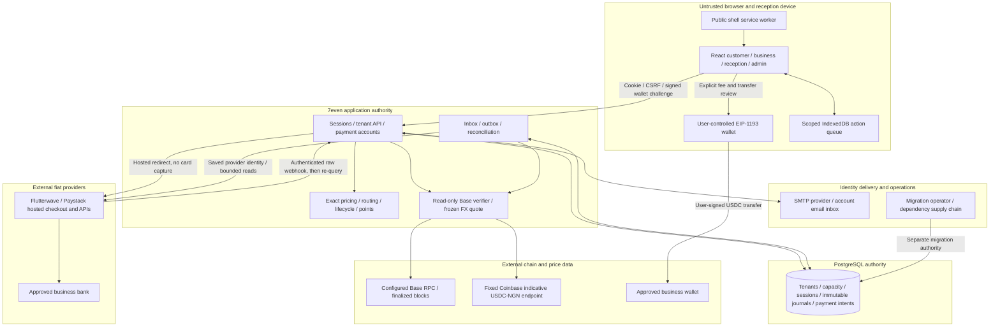

# Threat Model: 7even hospitality payments and operations

**Last refreshed:** 18 October 2026 at base commit `2394f1a10785f37872749a246f72e2028b6d0e63`, plus the uncommitted multi-provider feature worktree.
**Worktree status:** This document models the current source additions, not a committed or released payment integration. The [132-file source manifest](../7even/evidence/payments-source-manifest.json) records SHA-256 `c0ad5d349f4e8435f59ad9374ae99f2bec0d9dc23f0a94730be36c752c19afa9`; its sorted path/NUL/bytes/NUL algorithm and complete scope are recorded there. No production deployment or real-money approval is represented.
**Scope:** Implemented React customer/business/reception/admin interfaces, Express API, pure engine/contracts, PostgreSQL migrations, recovery workers, Flutterwave/Paystack adapters, native-USDC/Base verification, indicative FX and recovery email. Planned production controls are identified separately.
**Out of scope:** Execution of retired prototype code; unselected vendor PMS adapters/native installers; prevention of a compromised user OS or wallet stealing its own keys; DB-superuser/host compromise; provider/bank internals and underlying Base consensus or USDC issuer behavior. Regulatory, PCI and privacy certification require qualified review. No application LLM or autonomous model/tool execution was found; demand suggestions remain deterministic engine rules.

Severity uses the installed Helios [vulnerability taxonomy](../../../../.codex/plugins/cache/helios-sdlc-devkit/helios-sdlc-devkit/1.5.0/references/vulnerability-taxonomy.md). Ratings state the attacker position and remaining impact, not an unproved exploit. **Implemented** means the cited code/control exists. **Planned** identifies missing deployed controls or external acceptance. A missing test alone is an evidence gap, not a fabricated vulnerability. No security certification follows from this map.

## 1. System elements and trust boundaries

The browser does not establish role, tenant, price, funding, delivery, points or inventory. Business is the tenant; venue narrows reception access. PostgreSQL is authority for accepted state and journal effects. External calls are not atomic with database commits. Fiat routing uses the accepted NGN payable total: Paystack at or below 5,000,000 kobo, Flutterwave strictly above it (`packages/engine/src/paymentRouting.ts:5`). The provider/method/policy/destination is then fixed.

Native USDC goes entirely to the business wallet. Its 10% discounted-service commission is an NGN receivable, not collected platform cash (`services/platform/src/payments.ts:434`; `services/platform/src/store.ts:201`). The server holds no wallet signer. The payer and merchant independently authorize their own transfers; receipt verification relies on the configured Base RPC. Nonloopback RPC endpoints require HTTPS; HTTP is allowed only for loopback development nodes outside production (`services/platform/src/cryptoProvider.ts:359`). This transport check does not establish that the chosen RPC is honest. The indicative FX source is a valuation dependency, not an exchange service.

Sensitive data includes identity/contact details, bookings, memberships, session/recovery hashes, temporary recovery links, benefit codes, approved bank snapshots, public wallets linked to private booking records, and payment references. No active card/CVV collection or PHI input was found. Public chain addresses/hashes still reveal a customer-to-booking association when combined with private data. Business account/commission fields are stripped from the reception overview (`services/platform/src/app.ts:1204`); owning-business/admin projections remain privileged (`services/platform/src/store.ts:165`). Private API data is not service-worker cached.

The API currently listens on `0.0.0.0` (`services/platform/src/server.ts:6`), not loopback only. Vite and the restored local PostgreSQL use loopback, but no deployed API firewall, ingress or TLS configuration has been established. Production HTTPS checks in application startup are configuration checks, not evidence that a secure ingress exists (`services/platform/src/app.ts:66`).

## 2. Threat actors

| Actor | Position and capability | In scope |
|---|---|---|
| Anonymous client | Malformed requests, login abuse, forged callbacks and webhook payloads | Yes |
| Authenticated guest | Owns a wallet/account, repeats requests, guesses another booking/payment ID | Yes |
| Malicious business/reception member | Valid tenant role; attempts sibling-venue access, destination changes or false fulfillment | Yes |
| Phished administrator | Valid admin session; broad business, bank and moderation authority | Yes; no second factor is implemented |
| Compromised reception browser | Edits/deletes its queue and replays source IDs or requests | Yes up to server revalidation; OS persistence is excluded |
| Faulty/compromised provider, RPC or rate source | Delayed, duplicated, inconsistent or forged upstream evidence | Yes as an explicit trust assumption; underlying consensus/provider-internal prevention is excluded |
| Compromised application credential/dependency | Uses the runtime's schema-wide grants or process environment | Yes for authority and recovery impact; full host-compromise prevention is excluded |
| DB superuser or merchant wallet owner | Can bypass application storage controls or independently move its own wallet funds | Outside preventive scope; traceability, reconciliation and merchant obligations remain in scope |

## 3. STRIDE by element

### E1. Browser, static delivery and wallet prompts

| Threat (STRIDE) | Existing mitigation and evidence | Residual risk (severity) | Tag |
|---|---|---|---|
| S: Client claims provider success or another wallet | Server session reconstruction (`services/platform/src/app.ts:116`); payer signature and server verification (`services/platform/src/payments.ts:497`); wallet account/network check (`apps/web/src/lib/paymentWallet.ts:30`) | **Low** for client-only claims; a stolen session or compromised wallet remains a separate trust failure | Implemented |
| T: Altered price, provider route, redirect or token destination | Strict contracts; saved provider routing; exact hosted-origin allowlist (`apps/web/src/pages/customer/checkout.ts:4`); frozen crypto quote (`database/migrations/009_multi_provider_payments.sql:234`) | **Low** for the modeled input changes; malicious browser code can still display false instructions to its user | Implemented |
| R: Wallet timeout causes another send or UI claims an unverified transfer | Explicit gas-review/send step; one direct EIP-1193 send without method fallback (`apps/web/src/lib/paymentWallet.ts:115`); malformed returned hashes remain uncertain (`apps/web/src/lib/paymentWallet.ts:133`); structured rejection classification (`apps/web/src/lib/paymentWallet.ts:13`); submitted-hash/uncertain guard (`apps/web/src/pages/customer/CryptoCheckoutPage.tsx:152`) | **Medium** when a shared/compromised browser deletes local state or the user independently sends again; local UI state is not financial authority | Implemented |
| I: Private records or recovery URLs enter caches/referrers | API no-store (`services/platform/src/app.ts:94`); service-worker API exclusion (`apps/web/public/sw.js:29`); reset-token URL removal (`apps/web/src/pages/account/RecoveryPages.tsx:7`) | **Medium** on shared devices: rendered records and wallet/booking associations remain visible to the signed-in user | Implemented |
| D: Failed API or wallet blocks the whole flow | Abort/backoff read hook (`apps/web/src/hooks/useApi.ts:27`); popup errors and render boundary (`apps/web/src/App.tsx:97`) | **Medium** availability dependency on API, wallet and network; no deployed monitoring/failover is proved | Implemented / Planned operations |
| E: Injected JavaScript uses session or requests a malicious signature | React text rendering; constrained notifications (`services/platform/src/store.ts:45`); wallet signs the exact server quote message (`apps/web/src/lib/paymentWallet.ts:51`) | **Medium** because no deployed CSP is evidenced; wallet review cannot defend a fully compromised origin/dependency | Implemented / Planned hardening |

### E2. Authentication, sessions and account recovery

| Threat (STRIDE) | Existing mitigation and evidence | Residual risk (severity) | Tag |
|---|---|---|---|
| S: Credential stuffing, session guessing or phished admin | Random tokens/scrypt (`services/platform/src/auth.ts:7`); hashed session lookup and HttpOnly/SameSite cookie (`services/platform/src/app.ts:124`, `services/platform/src/app.ts:173`); persisted login counters (`services/platform/src/accounts.ts:51`) | **High** for one phished admin credential: broad consequential authority has no second factor | Implemented / Planned MFA |
| T: Cross-site mutation or reset replay | Exact Origin/CSRF except the two authenticated webhook paths (`services/platform/src/app.ts:135`); locked single-use reset and revocation (`services/platform/src/accounts.ts:115`) | **Low** for modeled CSRF/replay; browser and email ownership remain trusted | Implemented |
| R: Password/account change lacks attribution | Audit and recipient notification (`services/platform/src/accounts.ts:120`, `services/platform/src/accounts.ts:133`) | **Medium** because audit storage shares the application database; no independent tamper-evident export | Implemented / Planned operations |
| I: Enumeration or credential/recovery leakage | Generic recovery response and hash storage (`services/platform/src/accounts.ts:74`); password excluded from user projection (`services/platform/src/store.ts:136`) | **Medium** for compromised mailbox/DB access; local fixture mailbox intentionally contains live development links | Implemented |
| D: Sign-in/recovery exhausts compute or mail | Body limit (`services/platform/src/app.ts:104`); shared PostgreSQL counters (`services/platform/src/accounts.ts:42`) | **Medium** without verified proxy identity, ingress-wide abuse budgets or production load evidence | Implemented / Planned ingress |
| E: Registration/reset grants another identity or role | Strict registration schema and CUSTOMER insertion (`services/platform/src/app.ts:347`); recovery identifies account by its token (`services/platform/src/accounts.ts:108`) | **Low** for those paths; administrative provisioning still needs qualified review | Implemented |

### E3. Tenant, venue, administrator and destination onboarding

| Threat (STRIDE) | Existing mitigation and evidence | Residual risk (severity) | Tag |
|---|---|---|---|
| S: Caller supplies another business, venue or wallet | Live membership projection and tenant/venue guards (`services/platform/src/store.ts:136`, `services/platform/src/store.ts:584`); ownership challenge bound to business/revision/chain/address/expiry (`services/platform/src/paymentAccounts.ts:88`) | **Low** for supplied-ID spoofing; control of a wallet is not proof of a business's legal identity | Implemented |
| T: Destination edit redirects an existing payment | Owner signature, revision lock and pending review (`services/platform/src/paymentAccounts.ts:108`); admin checks current pending mapping (`services/platform/src/paymentAccounts.ts:199`); immutable attempt bank/wallet binding (`database/migrations/009_multi_provider_payments.sql:191`) | **Low** for rewriting historical destinations; independent real-business onboarding is still required | Implemented / Planned onboarding |
| R: Owner/admin denies a bank/wallet decision | Audited reason/reviewer and saved account revision (`services/platform/src/paymentAccounts.ts:261`); fiat mapping audit (`services/platform/src/app.ts:1463`) | **Medium** because one DB contains identity, decision and audit evidence | Implemented |
| I: Reception or another tenant reads payment-account details | Owner-only accounts API (`services/platform/src/paymentAccounts.ts:78`); reception strips accounts/commission (`services/platform/src/app.ts:1204`); payment access rechecks reservation (`services/platform/src/app.ts:514`) | **Medium** for a stolen authorized session; runtime DB privileges remain schema-wide rather than row-isolated | Implemented |
| D: Repeated revisions or malicious staff disrupts the business | Expected-revision checks and active membership enforcement (`services/platform/src/paymentAccounts.ts:144`; `services/platform/src/store.ts:584`) | **Medium**: an authorized owner can repeatedly submit a wallet and keep it pending; operational intervention is needed | Implemented |
| E: Phished admin maps a different settlement account | ADMIN plus provider lookup for fiat (`services/platform/src/app.ts:1463`); wallet additionally needs prior owner proof and current pending revision (`services/platform/src/paymentAccounts.ts:227`) | **High** for compromised admin fiat authority or failed merchant-identity review; no independent bank-change approver/MFA is implemented | Implemented / Planned review |

### E4. Pricing, inventory, rewards and PostgreSQL journals

| Threat (STRIDE) | Existing mitigation and evidence | Residual risk (severity) | Tag |
|---|---|---|---|
| S: Forged quote/payment obtains a booking or points | Server quote ownership and capacity allocation (`services/platform/src/reservations.ts:135`); paid-and-fulfilled earning gate (`services/platform/src/reservations.ts:262`, `services/platform/src/reservations.ts:275`) | **Low** for forged inputs; authorized staff can still dishonestly assert service delivery | Implemented |
| T: Concurrent overspend, last-room race or journal rewrite | Inventory/user row locks (`services/platform/src/reservations.ts:175`; `services/platform/src/benefits.ts:23`); balanced journal helper (`services/platform/src/store.ts:71`); DB balance/immutability triggers (`database/migrations/001_initial.sql:335`; `database/migrations/002_scope_and_funding.sql:10`) | **Low** for the enforced transactional invariants; actual infrastructure restore requires separate proof | Implemented / Planned recovery drill |
| R: Money loses its source or refund erases history | Provider-scoped receipt sources and saved original journal (`services/platform/src/payments.ts:291`); compensating refund (`services/platform/src/payments.ts:593`); write-once binding (`database/migrations/009_multi_provider_payments.sql:199`) | **Medium** for privileged restoration/manipulation because independent reconciled backups are not demonstrated | Implemented / Planned operations |
| I: Runtime credential exposes all tenant records | Distinct owner/app/read-only groups and retained-record privileges (`database/migrations/001_initial.sql:5`; `database/migrations/007_integrity_metadata.sql:21`) | **High** after runtime credential/process compromise: application grants are schema-wide and no tenant RLS backstop is implemented | Implemented |
| D: Large ranges or held locks block bookings | Bounded date/window contracts and stable inventory lock order (`packages/engine/src/lifecycle.ts:1`; `services/platform/src/reservations.ts:175`); pool size/connection timeout (`services/platform/src/db.ts:4`) | **Medium** under sustained authenticated traffic; no deployed query deadline/load-shedding proof | Implemented / Planned operations |
| E: Benefit or offline assertion bypasses financial rules | Separate entitlement model and locked ownership/revision (`services/platform/src/benefits.ts:63`, `services/platform/src/benefits.ts:181`); notes do not mark provider payment (`services/platform/src/operations.ts:157`) | **Low** for these modeled authority boundaries; new sector/value models require a fresh review | Implemented |

### E5. Flutterwave and Paystack hosted payment boundary

| Threat (STRIDE) | Existing mitigation and evidence | Residual risk (severity) | Tag |
|---|---|---|---|
| S: Forged callback/webhook or wrong provider credits payment | Flutterwave shared-hash comparison (`services/platform/src/provider.ts:51`); Paystack raw HMAC-SHA512 (`services/platform/src/paystackProvider.ts:95`); endpoint-to-saved-provider checks (`services/platform/src/app.ts:690`); independent re-query (`services/platform/src/payments.ts:497`) | **Low** for client-only forgery; stolen provider credentials or compromised upstream remain external trust failures | Implemented / Planned account validation |
| T: Amount/fee/subaccount/status confused between providers | Paystack integer-kobo parser and fixed split (`services/platform/src/paystackProvider.ts:30`, `services/platform/src/paystackProvider.ts:133`); Flutterwave exact decimal parser (`services/platform/src/provider.ts:37`); provider-scoped IDs (`database/migrations/009_multi_provider_payments.sql:67`) | **Low** for modeled unit/identity confusion; real account split/fee semantics still require sandbox acceptance | Implemented / Planned external verification |
| R: Timeout or conflicting later evidence causes duplicate charge/refund or hides review | Durable intent and uncertainty (`services/platform/src/payments.ts:116`, `services/platform/src/payments.ts:709`); read-only saved checkout resume (`services/platform/src/app.ts:478`); refund lookup without redispatch (`services/platform/src/payments.ts:1033`); delivered-refund identity/amount/status contradictions retain accounting and enter admin review (`services/platform/src/payments.ts:605`; `services/platform/src/app.ts:1381`) | **Medium** for upstream outcomes that cannot be found automatically; no distributed exactly-once guarantee | Implemented |
| I: Card, secret or bank snapshot reaches browser/logs | Hosted card collection; fixed server provider hosts (`services/platform/src/provider.ts:91`; `services/platform/src/paystackProvider.ts:117`); redacted durable event details (`services/platform/src/app.ts:693`) | **Medium** for privileged process/DB access; deployed secret storage/rotation and log-sink controls are unverified | Implemented / Planned operations |
| D: Provider outage or webhook flood blocks checkout | Fetch deadlines (`services/platform/src/provider.ts:96`; `services/platform/src/paystackProvider.ts:123`); durable bounded inbox (`services/platform/src/worker.ts:82`) | **Medium** availability dependence; authenticated floods can grow retained inbox without deployed global budgets | Implemented / Planned ingress |
| E: Receipt or processor report success falsely authorizes bank settlement | Flutterwave per-transaction destination/net/fee checks (`services/platform/src/payments.ts:1143`); Paystack reports validate identity/amount/fee and save redacted observations with bank delivery explicitly unconfirmed (`services/platform/src/paystackSettlement.ts:55`, `services/platform/src/paystackSettlement.ts:203`) | **Low** for a Paystack report being treated as bank credit: observations cannot post a settlement journal or set SETTLED; real bank-delivery acceptance is missing | Implemented / Planned external evidence |

### E6. Base RPC, payer proof and direct merchant USDC/refund

| Threat (STRIDE) | Existing mitigation and evidence | Residual risk (severity) | Tag |
|---|---|---|---|
| S: Public hash is stolen from another payer or signature reused | Exact quote-bound EOA message (`services/platform/src/cryptoProvider.ts:140`, `services/platform/src/cryptoProvider.ts:248`); actor/reservation access and payer verification before hash binding (`services/platform/src/payments.ts:497`) | **Low** for a guest submitting another payer's hash without wallet control; EOA compromise itself is outside prevention | Implemented |
| T: Wrong chain, bridged token, recipient, amount or nonfinal receipt | Native contract/chain allowlist (`services/platform/src/cryptoProvider.ts:20`); HTTPS RPC requirement with nonproduction loopback exception (`services/platform/src/cryptoProvider.ts:359`); exact uint256 amount and distinct wallets (`services/platform/src/cryptoProvider.ts:196`); canonical/finalized block plus exact call/log/inclusion checks (`services/platform/src/cryptoProvider.ts:480`); immutable quote (`database/migrations/009_multi_provider_payments.sql:234`) | **High** impact if the single configured RPC is malicious and fabricates consistent evidence; chain checks are RPC observations, not independently verified consensus proofs | Implemented / Planned RPC trust review |
| R: Direct payment or merchant return cannot be reconciled | Unique quote/hash and append-only refund proof (`database/migrations/009_multi_provider_payments.sql:142`, `database/migrations/009_multi_provider_payments.sql:167`); saved hash/finality verification and compensating journal (`services/platform/src/payments.ts:834`) | **Medium** for unresolved transfers or a merchant refusing to return funds; the platform cannot reverse a merchant's wallet unilaterally | Implemented / Planned merchant operations |
| I: RPC key or wallet/booking association leaks | Sanitized RPC errors (`services/platform/src/cryptoProvider.ts:325`); public-address-only stored ownership evidence (`services/platform/src/paymentAccounts.ts:154`); no private signer (`services/platform/src/cryptoProvider.ts:342`) | **Medium**: RPC sees queried public hashes and addresses become linked to bookings; secret-manager and retention policy are not deployed evidence | Implemented / Planned privacy operations |
| D: RPC/finality outage, malformed payload or expired hold stalls payment | 8-second RPC deadline/response cap/no retries (`services/platform/src/cryptoProvider.ts:313`); pending on missing/nonfinal evidence (`services/platform/src/cryptoProvider.ts:461`, `services/platform/src/cryptoProvider.ts:485`); 60-minute bounded hold (`services/platform/src/payments.ts:234`) | **Medium**: chain delay may outlast inventory hold; gas can be spent on a reverted/late transaction; review must preserve evidence without claiming a booking | Implemented / Planned external tests |
| E: Client directs platform custody/refund or commission becomes fictitious cash | Gateway is read-only (`services/platform/src/cryptoProvider.ts:342`); direct merchant return from original recipient to payer (`services/platform/src/payments.ts:834`); commission receivable and wallet-delivery classification (`services/platform/src/store.ts:201`, `services/platform/src/store.ts:312`) | **Medium** business risk from uncollected commission/refund refusal; no automatic platform collection or merchant-key custody is implemented or claimed | Implemented |

### E7. Indicative FX quotation source

| Threat (STRIDE) | Existing mitigation and evidence | Residual risk (severity) | Tag |
|---|---|---|---|
| S: Caller supplies its own rate or upstream URL | Fixed HTTPS rate endpoint and server-owned request (`services/platform/src/cryptoProvider.ts:25`, `services/platform/src/cryptoProvider.ts:383`); client contracts accept method/payer only | **Low** for client-supplied valuation; upstream identity/TLS remains trusted | Implemented |
| T: Stale/rounded rate underpays business or changes accepted terms | Freshness/header/size checks (`services/platform/src/cryptoProvider.ts:383`); exact ceiling-to-atom arithmetic (`services/platform/src/cryptoProvider.ts:130`); message binds rate/retrieval/expiry (`services/platform/src/cryptoProvider.ts:140`) | **High** consequence if the trusted source supplies a fresh but false rate: freshness is not independent price correctness and no second valuation source is implemented | Implemented / Planned valuation review |
| R: Business/customer disputes the applied valuation | Immutable quote includes source, retrieval time, exact rate and amount (`services/platform/src/cryptoProvider.ts:264`; `database/migrations/009_multi_provider_payments.sql:162`) | **Medium** commercial dispute risk; the rate is explicitly indicative, not an executable FX/redemption promise | Implemented |
| I: Quote lookup discloses customer information | Fixed public currency-pair request has no customer payload (`services/platform/src/cryptoProvider.ts:385`) | **Low** non-sensitive currency lookup disclosure; private booking-to-wallet links belong to E6 | Implemented |
| D: Rate API hangs or returns unusable data | Timeout, no-store, redirect rejection, age checks and response bound (`services/platform/src/cryptoProvider.ts:383`) | **Medium**: crypto checkout is unavailable when a fresh usable rate cannot be obtained; no silent stale-rate fallback | Implemented |

Elevation of privilege has no separate rate-record path: the response supplies a validated decimal value, not executable code, roles or destinations. Its financial influence is covered by tampering above.

### E8. Durable inbox, outbox and reconciliation workers

| Threat (STRIDE) | Existing mitigation and evidence | Residual risk (severity) | Tag |
|---|---|---|---|
| S: Event selects the wrong provider or execution environment | Persisted event provider compared with saved attempt and adapter mode (`services/platform/src/worker.ts:94`) | **Low** for authenticated-endpoint confusion; compromised DB credentials can still forge operational rows | Implemented |
| T: Concurrent/crashed worker repeats financial effects | Leases/SKIP LOCKED and same receipt transaction (`services/platform/src/worker.ts:82`); provider-scoped uniqueness and write-once identities (`database/migrations/009_multi_provider_payments.sql:67`, `database/migrations/009_multi_provider_payments.sql:191`) | **Low** for modeled replay/concurrency; restoration and multi-host clock behavior require operational validation | Implemented / Planned recovery drills |
| R: Exhausted work disappears or is marked successful | Errors/backoff retained (`services/platform/src/worker.ts:126`); capped recovery changes unresolved records to UNKNOWN with reasons (`services/platform/src/payments.ts:1056`); late delivered-refund contradictions remain in the admin exception queue (`services/platform/src/app.ts:1381`); admin operations counts (`services/platform/src/operations.ts:198`) | **Medium** until alert delivery, ownership and response procedures are exercised | Implemented / Planned operations |
| I: Notifications cross tenant/venue boundaries | Active member and event-venue filtering (`services/platform/src/worker.ts:170`); recipient-only notification reads (`services/platform/src/store.ts:488`) | **Low** for modeled event routing; text must remain minimal and free of secrets | Implemented |
| D: Unlimited polling or repeated restarts exhaust provider/DB quotas | Inbox five-attempt batches; recovery 25-row/120-check/30-second claim bounds (`services/platform/src/payments.ts:979`); Paystack reports persist 12-check/15-minute limits before lookup (`services/platform/src/paystackSettlement.ts:158`); 15-second local overlap guard (`services/platform/src/server.ts:9`) | **Medium**: manual verification still consumes upstream capacity, production quotas/global budgets are unverified | Implemented / Planned operations |
| E: Worker grants service/rewards from an untrusted event | Independent provider/chain verification before the shared receipt path (`services/platform/src/worker.ts:105`; `services/platform/src/payments.ts:497`); no autonomous price-publishing worker | **Low** for current worker authority; new PMS/model workers would add new trust boundaries | Implemented |

### E9. Reception, IndexedDB and first-party synchronization

| Threat (STRIDE) | Existing mitigation and evidence | Residual risk (severity) | Tag |
|---|---|---|---|
| S: Edited device/source IDs impersonate another property | Server session, active source and reservation venue checks (`services/platform/src/app.ts:1247`; `services/platform/src/reservations.ts:214`) | **Low** for fabricated IDs; a source is not hardware attestation or a vendor PMS identity | Implemented |
| T: Queue race or changed replay payload applies a stale action | Atomic IndexedDB write and event/revision identities (`apps/web/src/lib/receptionQueue.ts:40`, `apps/web/src/lib/receptionQueue.ts:109`); server source/hash checks (`services/platform/src/app.ts:1274`) | **Low** for covered queue integrity; a browser can still destroy an unsubmitted local queue | Implemented |
| R: Offline action appears complete despite a conflict | Pending/conflict UI and acknowledgment-based removal (`apps/web/src/pages/workspace/ReceptionPage.tsx:201`; `apps/web/src/lib/receptionQueue.ts:109`) | **Medium** if staff ignores unresolved work; no guaranteed offline sale or cold-start private-data availability | Implemented |
| I: Previous user or reception role sees excess financial records | Identity-scoped queue purge (`apps/web/src/context/SessionContext.tsx:9`); no API cache (`apps/web/public/sw.js:29`); payment account/commission removal from overview (`services/platform/src/app.ts:1204`) | **Medium** on shared devices due to IDs/operation times and authorized rendered records | Implemented |
| D: Queue grows indefinitely or offline work deadlocks | 50-item queue and bounded server batch (`apps/web/src/lib/receptionQueue.ts:72`; `packages/contracts/src/index.ts:206`) | **Low** local resource bound; new bookings, payments and benefit consumption still require the server | Implemented |
| E: Staff note or offline event asserts payment/points authority | Notes explicitly remain observations (`services/platform/src/operations.ts:157`); same lifecycle/payment check for sync (`services/platform/src/reservations.ts:224`) | **Low** for that authority separation; dishonest authorized fulfillment remains an operational risk | Implemented |

### E10. Email, runtime credentials, dependencies and operator deployment

| Threat (STRIDE) | Existing mitigation and evidence | Residual risk (severity) | Tag |
|---|---|---|---|
| S: Reset mail goes to an attacker-selected account | Known account lookup/canonical app origin (`services/platform/src/accounts.ts:74`); fixed sender and recipient delivery (`services/platform/src/recoveryMailer.ts:14`) | **Medium** without verified sender DNS, mailbox security and real SMTP delivery | Implemented / Planned external verification |
| T: SMTP downgrade or unreviewed schema/dependency change | Required TLS/certificate validation/no file or URL access (`services/platform/src/recoveryMailer.ts:57`); transactional checksum migration runner (`services/platform/src/migrate.ts:7`); locked viem/Nodemailer dependencies (`package-lock.json:1`) | **Medium** after compromised package/operator input; a lockfile is not an authenticity/security certification | Implemented / Planned supply-chain review |
| R: Mail/migration/restore success cannot be established | Delivery failure revokes link (`services/platform/src/accounts.ts:92`); checksummed migrations record applied files (`services/platform/src/migrate.ts:7`) | **Medium**: mail is not a durable queue; backup restoration and external reconciliation remain untested operations | Implemented / Planned operations |
| I: Environment, mailbox, logs or raw API listener exposes credentials/data | Private local-mailbox permissions (`services/platform/src/accounts.ts:29`); ignored env/local state (`.gitignore:1`); sanitized RPC errors (`services/platform/src/cryptoProvider.ts:325`) | **High** if all-interface API is exposed without intended HTTPS/network controls or production credentials leak; the current local run does not prove deployed ingress/secret controls (`services/platform/src/server.ts:6`) | Implemented / Planned deployment |
| D: Upstream outages or privileged migration blocks service | Provider/mail timeouts and bounded workers; transactional migration rollback (`services/platform/src/db.ts:14`; `services/platform/src/migrate.ts:7`) | **Medium** without exercised failover, restore, alert delivery and capacity plans | Implemented / Planned operations |
| E: Owner credential, default seed or poisoned dependency expands authority | Nonproduction-only explicit seed (`services/platform/src/seed.ts:8`); owner/app grant separation (`database/migrations/001_initial.sql:5`); production rejects mock/missing fiat credentials (`services/platform/src/app.ts:66`) | **High** for one owner/superuser misconfiguration or process-level dependency compromise; qualified production privilege/supply-chain review is required | Implemented / Planned deployment |

## 4. Prioritized residual risks and release evidence

1. **High, administrator compromise:** One phished admin credential can exercise consequential bank/business controls. Wallet changes add owner proof and pending review, but no second factor or independent fiat bank-change approver exists. Require qualified access/onboarding review before real-money use.
2. **High, external verification trust:** One configured RPC supplies transaction/canonical/finalized observations; one fixed source supplies the indicative rate. A malicious trusted source can provide internally consistent false evidence or valuation. These are explicit deployment trust assumptions, not evidence of a public client bypass. Review provider selection, monitoring, reconciliation and acceptable valuation exposure.
3. **High, runtime/deployment authority:** Schema-wide runtime access limits containment after application-credential theft, and the API binds all interfaces. Prove intended ingress/TLS/network controls, separate runtime/migration privileges and secret handling. No deployed infrastructure protection is inferred from local configuration.
4. **Medium, operations:** Uncertain payments/refunds stop at bounded UNKNOWN outcomes. Alerts, investigation ownership, merchant commission collection, direct-wallet refund cooperation and restore/reconciliation drills remain to be exercised. Staff notes and UI success messages are never external settlement proof.
5. **Medium, privacy/browser hardening:** Wallet-to-booking associations, shared devices, mailboxes and broad audit access need retention/access review. No deployed CSP or complete assistive-technology/device assessment is claimed.

Before real funds: obtain qualified review of money, authorization, tenant isolation and migrations; run current dependency/secret/static/API checks; validate Flutterwave and Paystack sandbox splits, fees, raw webhook delivery, unknown outcomes, refunds and bank settlement; validate Base Sepolia signatures, exact payments, finality/reorg handling and merchant returns; test alerting and restore/reconciliation. Real provider accounts, Base wallet payment/refund transactions and real SMTP delivery remain unverified. Paystack processor reports are recorded as observations. Without matching bank-delivery evidence they stay pending or flagged for review and are never labelled settled. Installed Nodemailer 10.1.2 and viem 2.57.7 resolve package availability, not these external proofs.

Fresh verification passed 234 unit/contract/frontend tests and 169 provider/PostgreSQL tests, with zero failures or skips. Typecheck/build passed. Lint retained 187 warnings and four information diagnostics; npm audit reported zero known advisories. The [payment verification record](../7even/PAYMENT_VERIFICATION.md) links raw outputs and selected browser captures, distinguishes synthetic providers from external acceptance, and records the limited credential-pattern check. These are bounded observations, not a security certification. This document does not authorize merge, deployment or real-money release.
